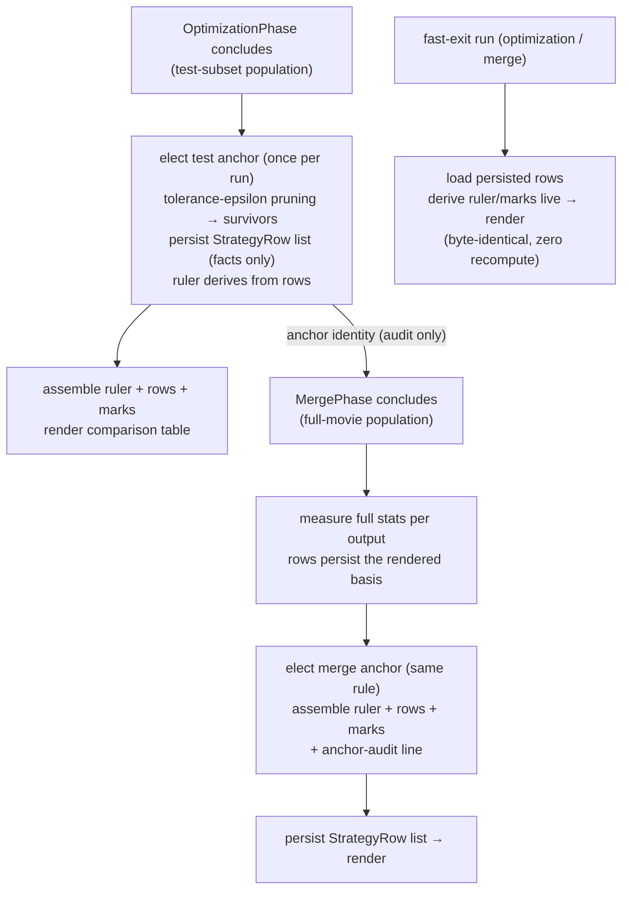

# Design Document

<!-- markdownlint-disable MD024 -->

- Spec: Unified Quality Summaries — one comparison table across optimization and merge
- Created: 2026-10-03
- Amended: 2026-10-12 — convergence rework (design sessions 2026-10-09 + 2026-10-12): one persisted row shape + one renderer, deltas in every mode, %-size deltas, ruler-row semantics, mode-dependent marks, tolerance-epsilon dominance, the shared plain-text formatter, merge presentation-bar closure
- Amended: 2026-10-17 — presentation restoration (the 2026-10-12 evening rulings lost on the unmerged branch tip re-land on main) + the negligible-band delta ruling (`≈` within `acceptance_delta`)

## Context

The fixed-quality spec shipped the anchor-relative comparison table at
optimization and, through two smoke-test review rounds, settled a compact
format: one size cell (MB + ×ratio vs anchor, anchor bare), one column per
metric carrying both compared statistics (anchor: `p10..median` range,
others: `Δp10/Δmedian`). That format was the seed. Merge printed a different
table (config-target verdicts), search runs printed a third (size/status),
and the two phases persisted different row shapes (`StrategySummaryRow`,
`MergeSummaryRow`).

Two foundations needed work before the table could live in two phases:

- **Key plumbing.** A metric-statistic identity is spelled `vmaf_median` in
  sidecars and `vmaf-median` on the CLI, joined and split ad hoc at every
  boundary, with no closed set of statistics. Table data is assembled from
  stringly keys throughout.
- **Data path.** The two phases persist different row shapes
  (`StrategySummaryRow`, `MergeSummaryRow`), and the merge renderer re-stats
  output files at render time instead of trusting its persisted sizes.

The 2026-10-12 amendment resolves the presentation direction completely
(judged through three sketch rounds on real run data):

- **Convergence is total** — one persisted row shape, one renderer, one
  mechanics pair (aggregate→persist→render on processing; load→render on
  fast exit). The renderer adapts to the data the population provides, never
  to phase identity.
- **Deltas everywhere** — strategy rows show Δ vs the ruler in both modes;
  absolutes live on the ruler row alone (targets in search, anchor in
  fixed).
- **%-size deltas** replace ×ratios, folded into the single size column,
  human-readable, and self-explanatory against the stated tolerance.
- **Marks are mode-dependent**: selection-only at optimization,
  recommendation (+ live verdicts in search) at merge.
- **Tolerance-epsilon dominance** gives fixed-mode pruning its bite, reusing
  the two tolerances that already exist.

## Flow



## The table model and its owner

A dedicated module (e.g. `pyqenc/summary_tables.py`) owns the comparison
table: the persisted row model, the render-time composition, and the
renderer. Nothing else.

```python
class StrategyRow(BaseModel):          # THE persisted shape, both sidecars
    strategy:   str                    # display name
    size_bytes: int
    metrics:    dict[MetricStatKey, float]   # canonical keys; breadth per Req 6.8

@dataclass(frozen=True)
class ComparisonTable:                 # render-time composition, never persisted
    rows:        list[ComparisonRow]   # sorted by size ascending; ruler folds in
    ruler:       Ruler                 # TARGETS (values ride the source/targets row) | ANCHOR (name) | NONE (uncompared)
    source:      SourceRow | None      # merge only: name + size (metric cells = targets in search)
    marks:       dict[str, Mark]       # derived live: SELECTED / RECOMMENDED / verdict glyph
```

Phases assemble `StrategyRow` populations from their own artifacts (winner
payloads, merged outputs, sidecars), persist them in their params sidecar,
and hand rows + ruler inputs to the renderer. The renderer is the ONLY place
cell text exists — the folded size cell, the delta pairs, the endpoints in
headers, marks, cues. A variant is a named configuration of constants, not a
fork.

Deltas, %Δ, and marks are computed at render time from absolute facts — so a
renderer change re-renders old runs' persisted tables without re-measuring
anything, and a changed verdict bar re-renders old rows correctly.

## Renderer and formatter

Two layers, one direction of dependency:

- **`format_table` (generic util, `pyqenc/utils/`)** — owns the plain-text
  mechanics only: column headers, rows, per-column left/right alignment,
  dash rule rows, dynamic widths (content and header maxima, with floor
  hints), suffix-safe truncation, and bare columns — content-only zones
  with no header text and no rule-row segment (an empty header is the
  candidate flag), so trailing zones like marks render through the
  formatter with real width computation and alignment instead of
  hand-appended text. Rule rows mark in-cell divider crossings: the
  formatter scans the cells it already renders per column and writes `+`
  at the same offsets (dashes elsewhere) — compound columns read as ruled
  sub-columns (`---------+------`; the lighter crossing keeps the
  emphasis on the column over the individual statistic, while data rows
  keep ` | `), pipe-free columns keep solid spans, so
  tables without sub-columns (the §119 remainder) render identically.
  Logger-plain output: 2-space column gaps, no ANSI,
  no borders, and a documented narrow-glyph constraint (the current
  `len()`-based behavior; wide or ambiguous-width glyphs stay out of table
  cells by convention). This is Req 10's deliverable — §119's mechanism,
  rejecting external libraries (research 2026-10-12).
- **The comparison renderer (`summary_tables`)** — owns every cell's TEXT:
  composes the folded size cell (MB right-aligned + fixed-width %Δ
  sub-value), the delta pairs, the header endpoints, ruler cues, marks, and
  the below-table detail lines; then hands finished rows to `format_table`.
  All presentation constants (separators, glyphs, cue strings, number
  formats) live here as named constants — switchable without touching
  either layer's logic.

Re-homing the remaining tables (winner-limiter, measure summary,
key-value) onto `format_table` is TODO §119's remainder — outside this
spec.

## Ruler row, deltas, and the size column

- **Search runs:** the ruler is the configured target set. At merge the
  target values ride the source row (◎-marked, `(src)` cue) — the source's
  own metric cells are undefined by construction (source-vs-source is
  perfect), so the cells are free. At optimization a standalone `targets`
  ruler row leads with no size value. Strategy rows show `Δlo | Δhi` per
  metric vs the targets; negative deltas are the visible miss story (a
  strategy can be selected while its test chunks still miss targets —
  selection is a size band over strategies with winners).
- **Delta cells:** each metric cell carries one signed difference per
  compared statistic, in the header's statistic order — never averaged or
  otherwise aggregated across statistics, rendered as right-aligned
  sub-columns (Req 2.8). The underlying value is a single
  aggregate over the population (worst-chunk value at optimization;
  the output's own pooled measurement at merge) — no per-winner
  distribution semantics. The pair exists so the two questions stay
  separable: the lower endpoint (p10, the floor) and the higher (median,
  the typical frame); a row that wins one and loses the other is exactly
  what the pair must expose.
- **Fixed runs:** the anchor is the ruler — ◎-marked, absolutes, bare size
  (the test anchor at optimization, the merge anchor at merge). Rows sort
  by size ascending; the ◎ mark locates the ruler wherever the sort places
  it (under tolerance-epsilon dominance a pruned row can be smaller than
  its dominator). Other rows show `Δlo | Δhi` vs the ruler's comparison
  stats.
- **Fixed runs always carry a ruler (§123):** the single-strategy skip
  applies to search only — a single-strategy fixed run elects its only
  strategy (the ruler row IS the strategy row; absolutes by construction);
  `--no-optimize` fixed runs test-encode with dominance pruning disabled
  (every strategy selected; anchor = the smallest test size — the
  unchanged smallest-survivor rule over an unpruned population). No-ruler
  absolute rendering has no fixed-mode case, save the no-measurement
  anchor (caveated rendering).
- **Size column:** one column — MB value + folded %Δ (`456.9 (+0.0%)`,
  `512.3 (-63.0%)`). Basis: source (merge) or smallest strategy row
  (optimization). The basis row carries no self-delta; the source row shows
  `(src)` instead. A positive %Δ inside the stated tolerance renders
  `(≈0.2%)` — the one-sided ≈ cue for the selection band (2026-10-17
  ruling); fixed mode's pairwise dominance makes the mark approximate
  there, an end-user cue only — the marks and the dominated-by detail
  lines carry the verdicts. With the tolerance stated in the legend, a
  cut row's `+12%` is self-explanatory — no separate cut annotation
  exists.
- **Alignment:** numeric cells right-aligned at uniform precision
  (decimal-point alignment); names left-aligned; suffix-safe truncation
  (`(src)`/`(anchor)` always survive). One blank line after the table before
  any detail lines.
- **Headers:** `VMAF  10% |  50%` — the compared statistics per metric,
  listed in the closed set's order and rendered as sub-columns (search:
  the per-metric targeted statistics; fixed: the comparison statistics);
  a single targeted statistic renders `VMAF  50%` with single-value cells.
  The ` | ` is the single value separator — a divider, not a range.
  Values ride UNDER the metric name (2026-10-12 night ruling): the header
  is one compact phrase (first label flush after the name, later labels
  right-aligned in their value-driven sub-widths), data lines carry no
  reserved name zone, and every data line composes to the same length —
  pipes align across data rows; the header's pipe may sit further right
  (~3 characters saved per metric column; terminals run ~100 wide).
  Absolute pairs carry one attention marker (`◆ 93.2 | 97.1` —
  semantically empty; deltas keep `+`/`-`; ruler-less tables unmarked).
  Deltas inside the metric's `acceptance_delta` render `≈`-prefixed
  (2026-10-17 ruling — the negligible band the dominance pruning
  ignores, mirrored for negative dust with the sign dropped at zero
  rounding).
- **Convention lines:** mode-native basis lines above the table, then a
  blank line — fixed: `anchor: ◎  h265+ultrafast` (the mode's own
  vocabulary; the table row keeps its `name (anchor)` suffix); search:
  `targets: ◎  configured (VMAF · PSNR · …)` naming the targeted
  metrics; ruler-less: no basis line. The legend line follows on every
  table (`Δ vs anchor · size Δ% vs source · ≈ negligible · ◀ recommended
  · size tolerance 5%`). The mark zone itself is a bare column (no
  header, no rule segment), so the legend lives here rather than in a
  column header.

## Anchor lifecycle: two elections, one audit

- **Per-population election.** Each table's ruler is elected from its own
  population by the same rule — smallest survivor of tolerance-epsilon
  pruning (test anchor at optimization, merge anchor at merge). The merge
  anchor rules the merge table and the fixed-mode presentation bar; the
  test anchor's values participate nowhere at merge. Neither ruler is ever
  persisted as values — each derives on demand from its population's
  persisted rows (a changed comparison stat set re-projects old
  measurements correctly).
- **Anchor audit at merge.** The test anchor's identity flows to merge via
  the optimization result — for comparison only. The below-table line
  always logs: stable at INFO (`anchor holds at full scale: h265-aq`), a
  shift at WARNING with both names (`anchor shifted at full scale: h265-aq
  (test subset) → h264 (full movie) — test chunk selection may not
  generalize`). When the election shifts, the test anchor's strategy is a
  regular row in the merge table — its deltas vs the merge anchor quantify
  the difference in-table; when it holds, the same strategy's two absolute
  rows (test population, full movie) are the audit.

## Tolerance-epsilon dominance

Replaces strict dominance in fixed-mode pruning (both dimensions reuse
existing configured bars — no new knobs):

```python
def _dominates(a: StrategyRow, b: StrategyRow, tolerance_pct: float) -> bool:
    if a.size_bytes > b.size_bytes * (1 + tolerance_pct / 100):
        return False                      # size tolerance: optimize_tolerance
    return all(                            # stat tolerance: per-metric acceptance_delta
        a.metrics[key] >= b.metrics[key] - acceptance_delta(key)
        for key in compared_keys
    )
```

A slightly-larger but clearly-better strategy can now dominate — the
flexibility the strict test lacked (0/4 pruned twice on real data). The
stat comparison is a per-statistic conjunction with **no compensation
across statistics or metrics**: a median surplus never covers a p10
deficit, mirroring the all-targets-pass semantics of search mode. The
tolerance doubles as noise absorption — tail statistics (p10) are noisier
estimators than the median, especially under subsampling, and both rows
are measured over the same frames (a paired comparison, so no
between-strategy sampling bias exists).

The anchor stays the smallest survivor; search-mode selection (the size
band) is untouched. Dominator attribution for the below-table `pruned:`
lines stays the first-in-resolved-order dominator. The comparison
direction is pinned here and confirmed on the two real-data cases in the
verification render.

## Metric-statistic pair type (minimal scope)

```python
class StatisticType(Enum):      # closed set, validated against the measurer
    MIN, P05, P10, P25, MEDIAN, P75, P90, P95, MAX, STD

@dataclass(frozen=True)
class MetricStatKey:            # hashable — the dict key of measured-metrics maps
    metric:    MetricType
    statistic: StatisticType

    def sidecar_key(self) -> str:   ...   # "vmaf_median" — THE canonical form
    def display(self) -> str:       ...   # "VMAF 50%" — THE display form (plot vocabulary)
    @classmethod
    def parse(cls, text: str) -> Self: ...  # tolerant separators + `med` alias;
                                            # unknown → loud ValueError
```

Display mapping: percentiles render as percents (`p10` → `10%`, `median` →
`50%` — the vocabulary the plots already use: `Min, 5%, 10%, …, 95%, Max`);
`min`/`max`/`std` stay words; metrics upper-case. Sidecar serialization
stays `vmaf_median`; the CLI/config vocabulary (`vmaf-med:96`) parses
unchanged. Pydantic dict-key fields use an annotated alias (the
`FingerprintYaml`/`CropYaml` pattern applied to keys) so `StrategyRow.metrics`
round-trips canonical strings on disk and typed keys in memory.

Scope fence: this spec lands identity + serialization + display + parse
only. The per-metric parser classes, the `QualityTarget` field fold, sidecar
retargeting, and the visualization `p5`/`p50` unification stay in TODO §116.
Existing stringly sidecar dicts convert at table assembly through the type's
own `parse` — no ad hoc `f"{metric}_{stat}"` / `rsplit` in new code.

Migration staging: the type + parse/serialize tests land first; then the
table module; then the phases. Each stage is independently green.

## Aggregate → persist → emerge

- **Processing runs:** phase concludes → assemble `StrategyRow` lists from
  artifacts → persist into the phase's params sidecar (`optimization.yaml`,
  `merge.yaml`) → render. Optimization rows carry the full worst-chunk
  statistics (min across test chunks, per statistic — the ruler
  re-derivation substrate); merge rows carry the rendered basis (the
  presentation bar's keys) — full retention stays on the per-video
  sidecars, and discrepancies re-actualize rows through the invalidation
  ladder.
- **Worst-chunk aggregation (why min across chunks).** The chunk is the
  evaluation currency: search mode demands every chunk meet its targets —
  no chunk compensates for another, the no-compensation principle one level
  up from statistics. The ruler must be a bar the anchor demonstrably
  clears on every chunk (an averaged ruler would sit above the anchor's own
  worse chunks and judge every other strategy unfairly). And the final
  video's floor statistics are driven by its worst chunks, so the
  worst-chunk probe previews the merge outcome. Known cost: min over a
  small test subset is high-variance and anomaly-sensitive — the
  test-chunk selection's start/end exclusions exist partly for this
  (§67's first-frame anomaly). The optimization row is thus a deliberately
  pessimistic floor probe; the merge row is the pooled full-movie truth —
  and the deliberate difference between them is what the anchor audit
  reads.
- **Fast-exit runs:** load rows → derive ruler + marks live → render. No
  winner-sidecar scans, no output re-stat. The merge renderer's live
  `safe_stat_size` is deleted — persisted `size_bytes` drive the table
  (byte-identical replay). `merge.yaml` carries `output_dir` once (not a
  path per row); the `Files named`/`Location` lines render from it plus the
  live source stem.
- Staleness of rows follows the pending-gate rule: any invalidated artifact
  routes the phase through the processing path, which rebuilds and
  re-persists.

## Merge measurement and the presentation bar

Merge measures the full statistic set per output (as today); rows persist
the rendered basis only — the presentation bar's keys:

| Surface | Search run | Fixed run |
|---|---|---|
| per-video sidecar | `targets`, target-keyed verdicts + metrics (as today) | pinned knob, anchor identity, full `metrics` (retention) — landed mode union |
| `merge.yaml` rows | rendered basis = target statistics | rendered basis = ruler statistics |
| `merge.yaml` extras | `output_dir` only (no per-row paths, no identity, no keys — landed) | same |

The presentation bar (search: config targets; fixed: the merge anchor's
synthetic set) feeds **every** merge presentation surface — the table's
ruler, the rows' rendered keys, and the per-output inline completion line
(closes §109: the processing path stops passing `plan.targets`
unconditionally; `_fmt_inline_metrics` reads the bar). Fixed runs carry no
configured-`targets` block anywhere in merge persistence, so a fixed merge
is never invalidated (nor re-measured) by configured-target changes.

## Verification render (Req 5)

The presentation constants are pre-settled through the 2026-10-12 rulings
(` | ` as THE single value separator — the sub-column divider, after
rejecting the `…`-and-`/` pair and the middle dot `·`; `◎` ruler glyph,
`(src)` cue, bare `0.0` zero, %-size deltas, one-decimal numbers,
right-aligned numeric cells). One task
renders the frozen renderer on a real work dir's data (4 strategies, an
anchor, near-ties inside both tolerance bars, a dominated case, and at
least one row that wins one statistic of a pair while losing the other —
the no-compensation demonstrator — the 2026-10-09 fixed-run shape, or
regenerated to that shape) and presents it for final visual confirmation.
Every constant is named; post-freeze tweaks
are constant flips.

## Correctness properties

1. **Facts stay absolute** — persisted rows carry only measured facts;
   deltas, %Δ, and marks exist solely at render time, so renderer changes
   never invalidate prepared data.
2. **No presentation leaks into decisions** — the anchors, the audit line,
   marks, and verdict glyphs never gate encoding, pruning (beyond the
   dominance rule itself), or merging.
3. **One election per population** — each table's ruler is elected from its
   own population (test anchor at optimization, merge anchor at merge); the
   test anchor's only role at merge is the audit.
4. **Fast-exit fidelity** — a fast-exit run renders byte-identical tables
   to the processing run that persisted them (persisted sizes, no
   re-stat).
5. **Mechanics untouched, presentation follows the run's goal** —
   decisions, artifacts, and non-summary logs are invariant for both
   modes; summary presentation adjusts to what each run pursues.
6. **Closed statistic vocabulary** — any statistic outside the closed set
   fails loudly at the parse boundary, never silently round-trips.
7. **Presentation is data-driven** — every glyph, delta, and mark derives
   from persisted facts plus the live bar at render; nothing is
   hand-assigned per row.
8. **One shape, caveated rendering** — the same row model and renderer
   serve all four populations; presentation branches only on data
   availability (source row, ruler, per-metric stat sets), never on phase
   identity.
