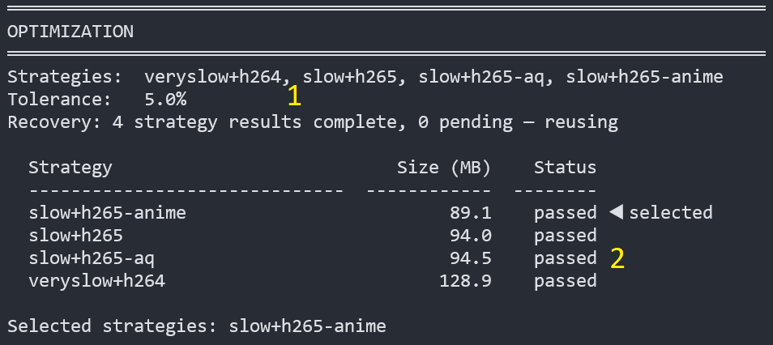
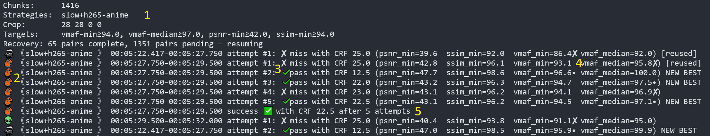
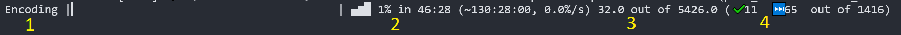

# pyqenc

<!-- markdownlint-disable MD024 MD026 MD028 -->

> WARNING: current project state is ALPHA. It could break or drastically change from version to version until stabilized. Also worth noting that this is a pet project, that is not really meant for production usage (though I do hope it is stable enough).

Encoding a movie sounds simple — until you spend hours tweaking quality settings, getting blurry edges or artifacts, or ending up with too huge of a file, or getting inconsistent results across scenes, or even losing everything to a power cut mid-encode.

**pyqenc** automates this. You tell it the quality you want (fixed or targeted). It does everything else:

- ✅ detects scenes,
- ✅ searches for suitable knobs,
- ✅ encodes each scene,
- ✅ merges encoded scenes back into a full video,
- ✅ recovers from interrupts with minimal possible loss of investments,
- ✅ processes audio, for you to pick the best variant,
- ✅ extracts attachments.

It only leaves the decision on what to mux into final movie to you.

> This project was inspired by [Av1an](https://github.com/rust-av/Av1an) and [Handbrake](https://handbrake.fr/).

---

## ⚡ Quick Start

**Step 1 — install dependencies once** ([FFmpeg](https://www.ffmpeg.org/), [MKVToolNix](https://mkvtoolnix.download/), and [uv](https://docs.astral.sh/uv/)):

```sh
# Windows (Scoop)
scoop install uv ffmpeg mkvtoolnix

# macOS (Homebrew)
brew install uv ffmpeg mkvtoolnix

# Linux (Ubuntu/Debian)
sudo apt install ffmpeg mkvtoolnix
# install uv separately: https://docs.astral.sh/uv/getting-started/installation/
```

**Step 2 — get pyqenc:**

```sh
git clone https://github.com/CHerSun/pyqenc.git
cd pyqenc
```

**Step 3 — install pyqenc** (uv handles the Python environment automatically):

```sh
uv tool install .
```

**Step 4 — run it:**

Run actual encoding with defaults:

```sh
pyqenc auto movie.mkv -y
```

> `.mkv` input is recommended. Other containers may work; if not, remux into `.mkv` via MKVmerge GUI first.

That's it. Default settings should work well. Later you can customize settings.

> Use a separate folder per encode job — either `cd` into a dedicated folder first, or pass `--work-dir <path>`. Don't run two encodes in parallel onto the same work dir.

The other intents: `pyqenc video movie.mkv -y` runs the video chain only, `pyqenc audio movie.mkv -y` the audio processing only, and `pyqenc extract movie.mkv -y` materializes streams (video and audio included) as standalone files.

For all options: `pyqenc auto --help` or [CLI Reference](docs/cli-reference.md).

---

## 🔍 How it works

### Scene-based encoding

The video is split into scenes first — detected directly from the source as timestamp windows, with no intermediate copy. Each scene is short and visually uniform — a dark scene, a fast-action sequence, a title card — they all have very different encoding characteristics. pyqenc assigns an independent quality parameter to each scene, so every scene gets exactly what it needs. Dark scenes get their own value, fast-moving scenes get theirs. No wasted bits, no scenes that look worse than others (this differs from native 2-pass encoding, where static scenes are prioritized).

### Quality targeting or fixed quality

You can use either quality targeting via metrics or specify fixed quality. For fixed quality - add `-q` argument, like `-q 18` - applied to all strategies.

For quality targeting mode you need to specify minimal thresholds to reach. The default config already has some setup. Either copy & adjust config (`pyqenc config . -y`), or you can override via `--targets` argument with a list of quality targets.

Quality targets are specified as `{metric}-{stat}:{value}[,{metric}-{stat}:value}]`, like `--targets vmaf-p10:95,vmaf-med:97,psnr-p10:44`.

Supported metrics: `vmaf`, `vif`, `ssim`, `psnr`.

Supported stats: `min`, `p05`, `p25`, `med`, `p75`, `p95`, `max`.

See [Quality Targeting Guide](docs/quality-targeting.md) for guidance on choosing good targets.

### 🔁 Resumption

pyqenc can be stopped at any point — power loss, `Ctrl+C`, whatever. Re-run the command targetting same work dir and same source to resume. Existing work is detected and reused automatically. If you've changed something between reruns - pyqenc will still try to reuse what's possible (consistency is the first target, so more work could be required on changes).

### Best strategy search

An encoding *strategy* is a combination of a profile and a codec preset (e.g. `h265-aq+slow`). Different strategies produce different size/quality tradeoffs.

By default, pyqenc tests all specified strategies on ~1% of chunks first, then encodes the full video using only the ones with the smallest output that still meets your quality targets. You get the best result without encoding the whole movie multiple times.

Use `--no-optimize` to produce one output per strategy — useful when you want to compare results side by side.

---

## 📁 Output

Results are written under the working directory:

```log
<work-dir>/
├── 📁 merged/       ← ✅ your encoded video(s), one per selected strategy
├── 📁 audio/        ← ✅ processed audio (one file per selected source track per chain)
├── 📂 extracted/    ← ✨ extracted source streams (subtitles, chapters, covers)
├── 📁 measure/      ← ✨ quality measurement outputs, if `measure` subcommand was run
├── 📂 encoding/     ← per-chunk encoding attempts with metrics (intermediate)
├── 📂 encoded/      ← winning chunk attempts (intermediate)
├── 📄 job.yaml      ← job parameters and source fingerprint
├── 📄 metrics.yaml  ← app metrics - how long each action has taken
└── 📄 *.yaml        ← per-phase parameters and state (probe, extraction, chunking, …)
```

- `merged/` and `audio/` folders hold the results you should care about. Pick the video and audio streams you want, then mux them together with MKVmerge GUI (drag&drop streams, export).
- `extracted/` might be useful if you want to add translations or edit subtitles, for example. Pipeline materializes only subtitles, chapters and attachments. If you want to materialize source video or audio - use `pyqenc extract source.mkv -y`. You can use `--include` and `--exclude` filters for better control of extraction along with dry-run (no `-y` flag).
- `measure/` holds results if you used `measure` subcommand directly. It can be used to compare source to other variants, including externally produced.
- Everything else is intermediate — preserved for inspection and resumption unless you use `--cleanup`.

Audio outputs are produced by user-defined **chains** (ordered filter recipes) applied to **selected** tracks, configured under `audio:` in your config file. Each output is named after its source audio stream: `<stream name> chain=<name>.<ext>`. See the [Audio Processing Guide](docs/audio-processing.md) for filters, chains, and track selection.

---

## AV1 encoding

AV1 profiles are also included in the default config, but not enabled by default. If you want to target AV1 codec specifically you can:

```sh
pyqenc auto movie.mkv --strategies "av1*" -y
```

This will test all defined AV1 profiles and select the optimal ones for the full encoding.

AV1 strongly smoothes content. If you want to encode crispy (cartoons/anime) or noisy (older movies, natural grain) - AV1 is a bad choice. AV1 wins on modern content.

> NOTE: Your devices could lack AV1 hardware decoding support and struggle with the codec.

## h264 encoding

h.264 codec is **NOT recommended** for use with pyqenc.

h264 is an older generation codec. It has a caveat that could ruin pyqenc encoding - h264 stores codec private data once. While pyqenc encodes each chunk separately. This could cause different codec private data on chunks. When merges - video won't play correctly. Default config adds extra measures against that, but doesn't guarantee full compatibility.

## 📊 Measuring quality

You can measure quality metrics between any source and encoded video(s), including results from other encoders:

```sh
pyqenc measure source.mkv encoded.mkv [other.mkv ...]
```

Outputs go under `<work-dir>/measure/`: per-target metrics YAML, quality plot over duration, and screenshots.

---

## ⚙️ Configuration

pyqenc works out of the box. When you want to customize — codecs, presets, profiles, default targets — copy the active config and edit it:

```sh
pyqenc config .     # preview: would show which config is active and where it will be copied to
pyqenc config . -y  # execute the copy
```

Config build order: built-in defaults → `~/.config/pyqenc/config.yaml` → `./pyqenc.yaml` . Later config override prior ones. Lists and values get fully replaced, dicts are merged.

---

## 📺 Progress display

### Optimization phase summary



1. Input summary — strategies, tolerance, recovery status
2. Results — strategies tested, sizes, selected strategy(ies) for full encoding

### Encoding attempts log



1. Summary — strategies, chunks, cropping, quality targets, recovery
2. Visual hash emoji + strategy name + chunk id
3. Attempt number and status (`pass` / `miss`)
4. Quality metrics snapshot — least-performing metric marked `✘` (miss) or `•` (pass)
5. Chunk success — winning attempt found

### Encoding progress bar



1. Action in progress
2. %-based progress and ETA
3. Duration-based progress (seconds of video remaining after recovery)
4. Chunk-count progress: `✔` completed, `⏭` reused, `✘` failed

---

## 🔧 Troubleshooting

**FFmpeg / MKVToolNix not found** — install them and ensure they're in your PATH (`ffmpeg -version`, `mkvmerge --version`).

**Insufficient disk space** — the whole process typically needs several times the source size (attempts for several strategies + audio + merged outputs). Before encoding, pyqenc logs a space estimate (required and recommended ranges) against the available space. Use `--work-dir` to point to a larger disk if required.

**Slow encoding** — try a faster codec or faster codec preset (`fast`, `medium`). If CPU is not fully utilized - add `--concurrency 2` or higher. OR switch to GPU-encoding. Besides concurrency all other options affect resulting quality and/or size. Effective encoding is slow and CPU-only. You can also choose to use fixed quality encoding instead of quality targeting - quality search is costly, convergence is in ~4.1 attempts currently.

**Strategy wildcard not expanding** — some shells require quoting: `"h265*"`. Use dry-run to verify expansion. Verify that the config does have the wanted profiles.

**Debug logging** — add `--log-level debug` to any command for detailed output.

---

## 📚 Further reading

- [CLI Reference](docs/cli-reference.md) — all options, quality target format, strategy format
- [Quality Targeting Guide](docs/quality-targeting.md) — metric pitfalls, recommended targets, VIF vs VMAF, narrowing the quality search range
- [Sample Comparison](docs/sample-comparison.md) — pyqenc vs BSEncode side-by-side
- [Architecture](docs/architecture.md) — pipeline internals

---

## License & contributing

Open-source. See [LICENSE](LICENSE) for details. Contributions welcome — see [CONTRIBUTING.md](CONTRIBUTING.md).
